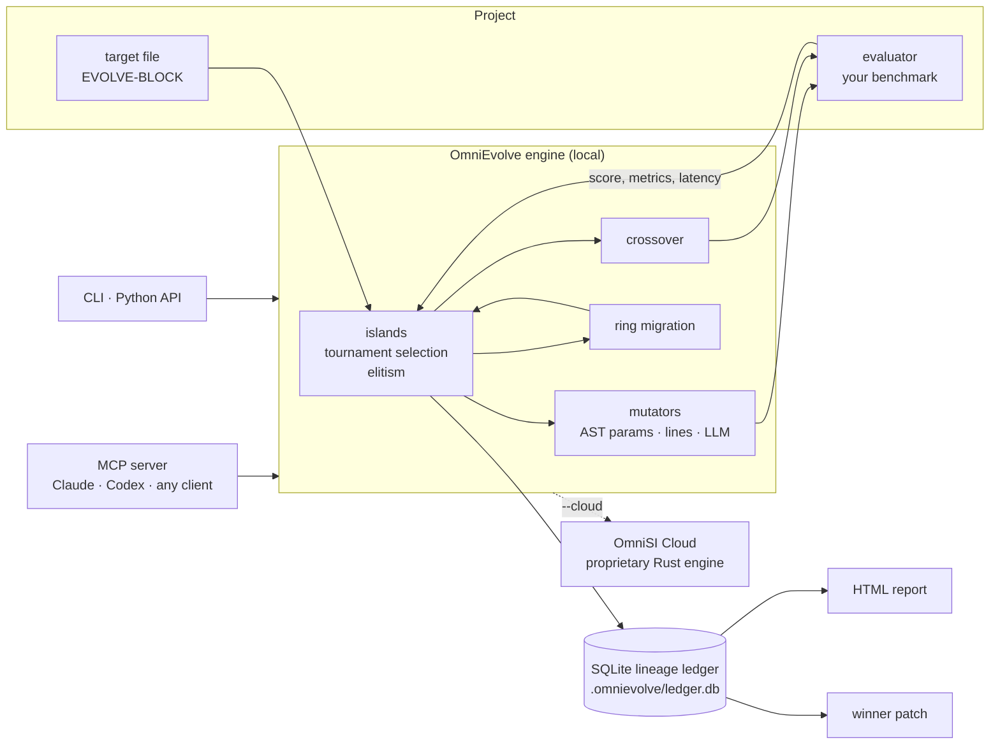

# OmniEvolve

**Evolutionary optimization for code and prompts, on your machine.**

OmniEvolve improves one file at a time (a Python heuristic, a prompt template, a JSON config)
by running an island-model evolutionary search against a benchmark you already have. Every
candidate, score and parent-to-child diff is recorded in a local SQLite lineage ledger, and each
run renders to a self-contained HTML report. It works offline with no API keys, and it can use
the model of your choice (OpenAI, Anthropic, Gemini or Ollama) to propose rewrites.

[](https://github.com/omnirogue/omnievolve/actions/workflows/ci.yml)


- **Zero dependencies.** Python 3.10+ standard library only: `sqlite3`, `ast`, `difflib`,
  `subprocess`, `json`, `urllib`.
- **Any benchmark is an evaluator.** If a command can print a score, OmniEvolve can optimize
  against it. Python callables and LLM judges plug in the same way.
- **Offline by default.** The built-in deterministic mutator edits numeric parameters through
  the Python AST (comments and formatting survive) and edits prompt lines from a pool you
  provide. Runs are reproducible from a seed, even with parallel evaluation.
- **Bring your own model.** The LLM mutator calls your provider with your key and falls back to
  the deterministic operators when a call fails.
- **Full lineage.** Every run, generation, island, candidate, score, latency and unified diff is
  queryable SQL. Export the winner as a patch that `git apply` accepts.
- **Agent-ready.** A stdio MCP server lets Claude, Codex and other MCP clients run searches and
  fetch the winning patch.

## 60-second quickstart

```bash
git clone https://github.com/omnirogue/omnievolve
cd omnievolve
pip install -e .        # optional: no dependencies; or use `python3 -m omnievolve` in place of `omnievolve`

omnievolve run --config examples/heuristic_tuning/omnievolve.json --generations 5 --html evolution-report.html
```

```text
OmniEvolve 0.1.0 · ticket-triage-heuristic · target triage.py · 2 islands x 6 · 5 generations
seed        score 0.553571
gen   0     best 0.567976  [i0=0.567976  i1=0.558952]  evals 11  cache 0
gen   1     best 0.666667  [i0=0.666667  i1=0.562118]  evals 21  cache 0
gen   2     best 0.666667  [i0=0.666667  i1=0.576497]  evals 31  cache 0
gen   3     best 0.719745  [i0=0.719745  i1=0.719745]  evals 41  cache 0
gen   4     best 0.739796  [i0=0.719745  i1=0.739796]  evals 51  cache 0
gen   5     best 0.739796  [i0=0.719745  i1=0.739796]  evals 61  cache 0

best 0.739796 (seed 0.553571, +0.186225) · candidate g004-i1-00 · run run-20261016-...
ledger  examples/heuristic_tuning/.omnievolve/ledger.db
report  evolution-report.html
```

The example tunes the weights and threshold of a support-ticket triage heuristic. The evaluator
scores F1 on 600 synthetic tickets, so five generations (61 evaluations, four in parallel) take
about a second, and the seed makes the run reproducible: you should see the same numbers. Then:

```bash
omnievolve leaderboard --ledger examples/heuristic_tuning/.omnievolve/ledger.db
omnievolve export-winner --ledger examples/heuristic_tuning/.omnievolve/ledger.db --output best.patch
(cd examples/heuristic_tuning && git apply ../../best.patch)     # or: patch -p1 < ../../best.patch
open evolution-report.html                                       # xdg-open on Linux
```

Start your own project with `omnievolve init my-project`: it writes a config, a target program
and an evaluator you can replace with your own benchmark.

## How it works



Each generation, per island:

1. **Select parents** by tournament (`tournament_size` contenders; best wins).
2. **Propose children**: mutate one parent, or cross two over (`crossover_rate`). Children
   that repeat an already-evaluated program are re-drawn a few times (`max_attempts`), and true
   duplicates reuse the cached score instead of re-running the benchmark.
3. **Evaluate** the children, in parallel with `workers > 1`. Each child is written to a scratch
   directory under its real file name and handed to the evaluator.
4. **Select survivors**: the island's `elite` best plus the children (`generational`), or the
   best of parents and children together (`plus`).
5. **Migrate** every `migration_interval` generations: each island sends its best
   `migration_size` candidates to the next island in a ring, replacing that island's weakest.

Every random choice comes from a stream seeded by `search.seed` (one per island, one per
child), so the same seed, evaluator and deterministic mutator give the same run whether
evaluation is sequential or parallel.

## Configuration

`omnievolve.json` (YAML works too with `pip install 'omnievolve[yaml]'`). Paths are relative to
the config file.

```json
{
  "name": "ticket-triage-heuristic",
  "target": "triage.py",
  "evaluator": {
    "type": "subprocess",
    "command": ["{python}", "evaluate.py", "{candidate}"],
    "timeout_seconds": 10
  },
  "mutator": {"type": "deterministic", "sigma": 0.6, "max_changes": 3},
  "search": {
    "generations": 8, "islands": 2, "population": 6, "elite": 1,
    "tournament_size": 3, "crossover_rate": 0.25,
    "migration_interval": 3, "migration_size": 1,
    "survivors": "generational", "seed": 7, "workers": 4
  },
  "objective": "maximize",
  "ledger": ".omnievolve/ledger.db"
}
```

| Setting | Default | Meaning |
| --- | --- | --- |
| `target` | required | The file to evolve. If it contains `EVOLVE-BLOCK-START` / `EVOLVE-BLOCK-END` marker lines, only the lines between them change. |
| `evaluator` | required | How to score a candidate (see below). |
| `mutator` | deterministic | `deterministic` or `llm` (see below). |
| `search.generations` | 8 | Generations after the initial population. |
| `search.islands` | 2 | Independent sub-populations. |
| `search.population` | 6 | Members per island. |
| `search.elite` | 1 | Best members kept unchanged each generation. |
| `search.tournament_size` | 3 | Contenders per parent selection. |
| `search.crossover_rate` | 0.25 | Share of children made by crossover. |
| `search.migration_interval` / `migration_size` | 3 / 1 | Ring migration cadence and size (0 disables). |
| `search.survivors` | `generational` | `generational` (elites + children) or `plus` (best of both). |
| `search.seed` | 7 | Random seed. |
| `search.workers` | 1 | Parallel evaluations. |
| `search.patience` | none | Stop after this many generations without improvement. |
| `search.target_score` | none | Stop once the best score reaches this. |
| `objective` | `maximize` | Or `minimize` (for latency, error, cost). |
| `ledger` | `.omnievolve/ledger.db` | Ledger database. |
| `report` | none | Write the HTML report here after each run. |
| `cloud` | `{}` | OmniSI Cloud settings: `objectives`, `usd_cap`, `execution_tier`. |

CLI flags (`--generations`, `--islands`, `--population`, `--seed`, `--workers`, `--ledger`,
`--html`) override the file.

## Evaluators

An evaluator turns a candidate file into a score. Higher is better unless `objective` is
`minimize`. A candidate whose evaluation fails (non-zero exit, timeout, exception, no score)
is recorded with its error and simply loses selection; it never stops the run.

**Subprocess** (any language). The command runs once per candidate with your project directory
as the working directory and on `PYTHONPATH`. Placeholders: `{candidate}` (the candidate file),
`{candidate_dir}`, `{project}`, `{python}` (the current interpreter). The candidate path is also
in `OMNIEVOLVE_CANDIDATE`. Print either a JSON object (`{"score": 0.91, "latency_ms": 12}`;
other numeric keys become metrics) or a bare number on the last line. On timeout the whole
process group is killed.

```json
"evaluator": {"type": "subprocess", "command": ["./bench.sh", "{candidate}"], "timeout_seconds": 120}
```

**Python callable** (fast, in-process, not isolated):

```json
"evaluator": {"type": "python", "callable": "evaluate.py:score"}
```

**LLM judge**: grades the candidate against a rubric and returns a score in [0, 1]. With
`samples` > 1 it averages several judgments and reports their spread as `judge_spread`.

```json
"evaluator": {"type": "llm_judge", "provider": "anthropic", "model": "claude-sonnet-5-5",
              "rubric": "@rubric.md", "samples": 3}
```

**Composite**: a weighted mean of several evaluators; each part's score and metrics are kept.

```json
"evaluator": {"type": "composite", "parts": [
  {"name": "tests", "weight": 3, "type": "subprocess", "command": ["{python}", "run_tests.py", "{candidate}"]},
  {"name": "style", "weight": 1, "type": "llm_judge", "provider": "ollama", "model": "llama3.1", "rubric": "@style.md"}
]}
```

**Your own class** (the plugin SDK):

```python
from pathlib import Path
from omnievolve import Evaluator, EvaluationResult

class Throughput(Evaluator):
    name = "throughput"

    def _evaluate(self, candidate_path: Path, source: str):
        ops = run_benchmark(candidate_path)          # your code
        return EvaluationResult(score=ops, metrics={"p99_ms": measure_p99(candidate_path)})
```

Return a number, a dict with `score`, or an `EvaluationResult`. The base class handles timing
and turns exceptions into failed results.

## Mutators

**Deterministic** (default, offline). On Python targets it parses the file with `ast` and
perturbs numeric literals: inside `EVOLVE-BLOCK` markers when present, otherwise in module-level
assignments, otherwise anywhere. Only the literal's characters change, so comments and layout
survive. Floats take Gaussian steps scaled by `sigma`; integers step by at least 1 and stay
non-negative when they start that way. Crossover mixes parameters from two parents. On text
targets it perturbs numbers and, with a `line_pool` file, adds, removes, replaces and swaps
lines, with line-level crossover.

```json
"mutator": {"type": "deterministic", "sigma": 0.25, "max_changes": 2,
            "line_pool": "mutation_pool.txt", "numeric_rate": 0.2}
```

**LLM** (bring your own key). The model sees the current file, its score and metrics, and the
island's strongest other candidates, and returns a complete rewritten file. Replies that are not
valid Python, drop the EVOLVE-BLOCK markers or fail to arrive fall back to the deterministic
operators.

```json
"mutator": {"type": "llm", "provider": "openai", "model": "<model id>", "temperature": 0.7,
            "instructions": "@task.md", "fallback": {"sigma": 0.3}}
```

| Provider | Key variable (default) | Notes |
| --- | --- | --- |
| `openai` | `OPENAI_API_KEY` | `base_url` (or `OPENAI_BASE_URL`) reaches any OpenAI-compatible server: vLLM, LM Studio, OpenRouter. |
| `anthropic` | `ANTHROPIC_API_KEY` | Messages API. |
| `gemini` | `GEMINI_API_KEY` or `GOOGLE_API_KEY` | The key goes in a header, never the URL. |
| `ollama` | none | `base_url` or `OLLAMA_HOST`, default `http://localhost:11434`. |

`api_key_env` names a different variable. Keys are read at call time and never written to the
ledger, the report or error messages. From the CLI: `omnievolve run --mutator llm --provider
anthropic --model claude-sonnet-5-5`.

## Ledger, leaderboard and report

The ledger is plain SQLite:

| Table | One row per |
| --- | --- |
| `runs` | run: config, status, best candidate, timings |
| `generations` | generation and island: best and mean score, evaluations, cache hits, failures, migrants |
| `islands` | island at the end of a run |
| `candidates` | candidate: full source, score, metrics, latency, operator, error |
| `lineage` | parent-to-child edge (`primary`, `secondary` for crossover, `migrant`) with its unified diff |

```bash
sqlite3 .omnievolve/ledger.db "SELECT operator, COUNT(*), MAX(score) FROM candidates GROUP BY operator"
omnievolve runs --ledger .omnievolve/ledger.db
omnievolve leaderboard --ledger .omnievolve/ledger.db --limit 5 --json
omnievolve report --ledger .omnievolve/ledger.db --output evolution-report.html
```

The report is one dark-mode HTML file with no external resources: headline numbers, the
fitness curve per generation (best so far and each island's best, with a table view), the
lineage of every candidate with the winner's ancestry highlighted, island and candidate
leaderboards, the step-by-step ancestry of the winner with each step's diff, and the winning
patch.

## MCP server

`omnievolve-mcp` speaks MCP over stdio and exposes three tools:

| Tool | What it does |
| --- | --- |
| `omnievolve_run` | Runs a project (`config_path`, optional `generations`, `islands`, `population`, `seed`, `workers`, `ledger_path`, `html_path`) and returns the summary. |
| `omnievolve_leaderboard` | The best candidates of a run. |
| `omnievolve_export_winner` | The seed-to-winner unified diff, optionally written to `output_path`. |

Every path must stay inside `--root`, because running a project executes its evaluator.

**Claude Code**

```bash
claude mcp add omnievolve -- omnievolve-mcp --root /path/to/your/projects
```

**Claude Desktop** (`claude_desktop_config.json`)

```json
{
  "mcpServers": {
    "omnievolve": {"command": "omnievolve-mcp", "args": ["--root", "/path/to/your/projects"]}
  }
}
```

**Codex** (`~/.codex/config.toml`)

```toml
[mcp_servers.omnievolve]
command = "omnievolve-mcp"
args = ["--root", "/path/to/your/projects"]
```

Without installing, use `"command": "python3", "args": ["-m", "omnievolve.mcp_server", "--root",
"..."]` with `PYTHONPATH` pointing at this repository.

## Python API

```python
from pathlib import Path
from omnievolve import (DeterministicMutator, EvolutionEngine, Ledger, SearchConfig,
                        SubprocessEvaluator)

with Ledger(".omnievolve/ledger.db") as ledger:
    result = EvolutionEngine(
        seed_source=Path("triage.py").read_text(),
        target_name="triage.py",
        evaluator=SubprocessEvaluator(["python3", "evaluate.py", "{candidate}"]),
        mutator=DeterministicMutator(sigma=0.6, max_changes=3),
        config=SearchConfig(generations=8, islands=2, population=6, seed=7, workers=4),
        ledger=ledger,
    ).run()
print(result.summary())
```

## OmniEvolve Open Source (Python Local Engine) vs. OmniSI Cloud (Proprietary Rust Engine)

OmniEvolve is a complete optimizer on its own. OmniSI Cloud (powered by the proprietary OmniRogue Rust Engine)
runs the same projects as a hosted, multi-objective service; `omnievolve run --cloud` submits a
project to it. The Rust engine is not part of this repository.

| | **OmniEvolve** (this repository) | **OmniSI Cloud** |
| --- | --- | --- |
| License | Apache-2.0, free | Commercial hosted service |
| Engine | Python, standard library only | Proprietary Rust engine |
| Where it runs | Your machine | Hosted; evaluations on sandboxed fleet workers |
| Search | Island model, tournament selection, elitism, crossover, ring migration | High-concurrency Rust tournaments |
| Objectives | One score (a weighted composite for several) | Multi-objective Pareto-frontier selection |
| Diversity | Islands and content-hash de-duplication | Novelty archive search |
| LLM judging | Rubric judge with averaged samples | Swap-order calibrated JEV judging with position-bias correction |
| Stopping | Generations, patience, target score | Statistical sequential early stopping |
| Audit trail | SQLite lineage ledger, HTML report, winner patch | Cryptographic SHA-256 audit bundles |
| Evaluator isolation | Subprocess with a timeout, on your machine | Sandboxed fleet workers |
| Rollout | `export-winner` patch | Canary promotion and rollback, spending caps |
| Interfaces | CLI, Python API, stdio MCP server | REST and SSE API, `omnievolve run --cloud` |

`--cloud` sends nothing until you leave out `--dry-run`, which prints exactly what would be
sent. The payload is the target file, the evaluator, mutator and search settings, and your
project's text files; secret-bearing names (`.env*`, `*.pem`, `*.key`, credential files) and
local ledgers are always skipped. The endpoint and key come from `OMNISI_CLOUD_URL` and
`OMNISI_API_KEY`.

```bash
omnievolve run --config omnievolve.json --cloud --dry-run    # inspect the payload, send nothing
omnievolve run --config omnievolve.json --cloud --wait       # submit and wait for the result
```

## Examples

| Example | What evolves | Evaluator |
| --- | --- | --- |
| [`examples/heuristic_tuning`](examples/heuristic_tuning/) | Weights and threshold of a ticket-triage heuristic | F1 on 600 synthetic tickets, offline: 0.554 to 0.740 in 5 generations |
| [`examples/prompt_evolution`](examples/prompt_evolution/) | A customer-support system prompt | A synthetic test suite with a simulated assistant, offline: 0.661 to 0.959 in 10 generations |

## Security

Evaluators run code: a subprocess evaluator runs your command, and the candidate is a program
the search wrote. Run OmniEvolve on projects you trust, use subprocess evaluators with timeouts
for untrusted candidates, and run it in a container or VM when the benchmark touches anything
valuable. The MCP server confines every path to `--root`. Report vulnerabilities as described in
[SECURITY.md](SECURITY.md).

## Development

```bash
python3 -m unittest discover -s tests      # the suite, standard library only
python3 scripts/release_check.py           # license headers, no artifacts or credentials
ruff check . && ruff format --check .      # with pip install -e '.[dev]'
```

See [CONTRIBUTING.md](CONTRIBUTING.md). Supported on Linux and macOS with Python 3.10 to 3.13;
Windows is untested.

## License

Apache License 2.0. See [LICENSE](LICENSE) and [NOTICE](NOTICE).
